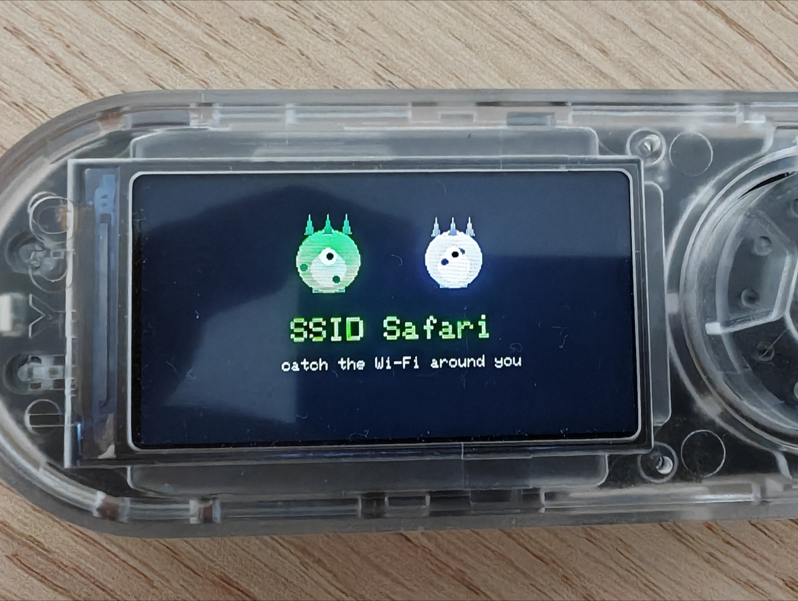
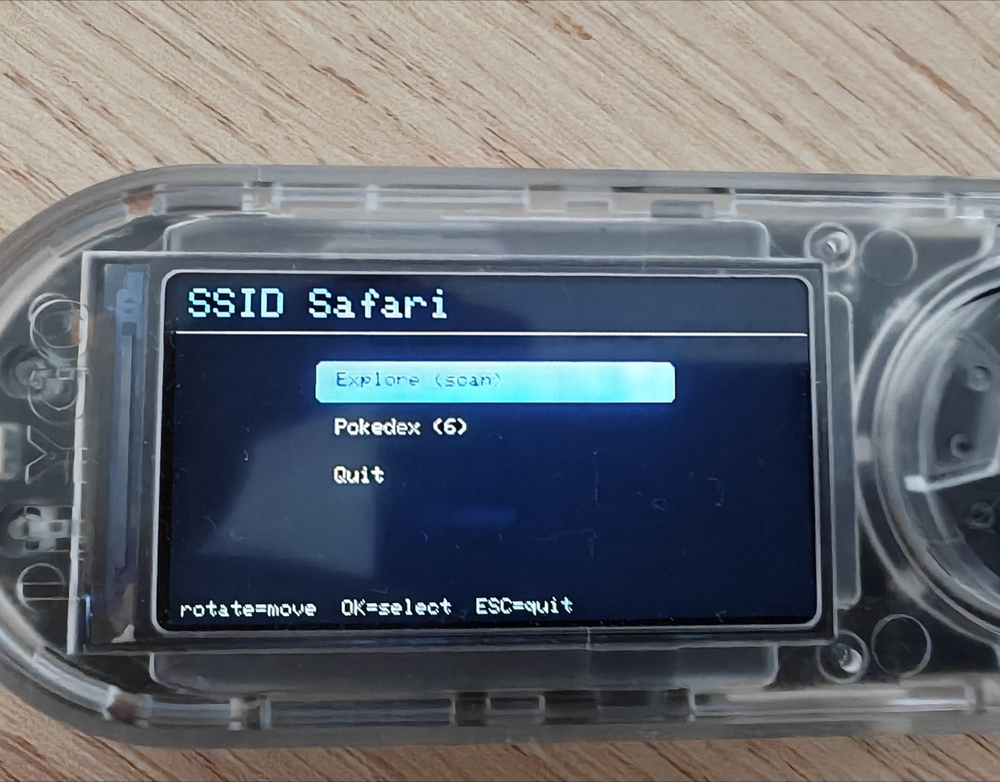
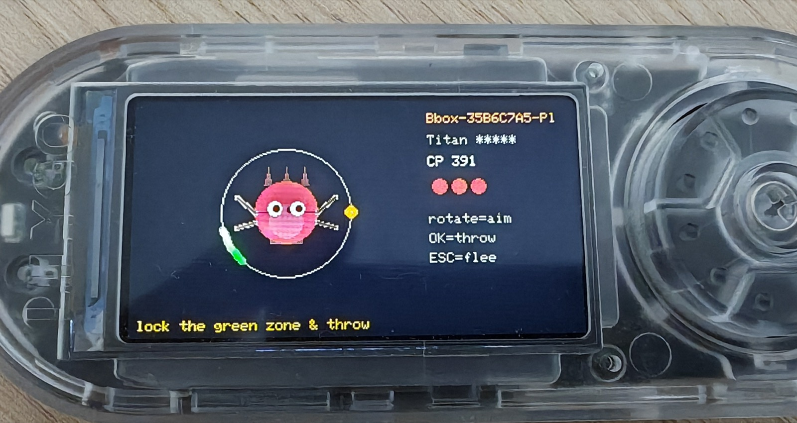

# 🐾 SSID Safari — Bruce / LilyGO T-Embed CC1101

🇺🇸 <a href="README.md">English</a> · 🇫🇷 <b>Français</b>

  [-F7DF1E)](https://github.com/BruceDevices/firmware) 

Attrape les **réseaux Wi-Fi réels autour de toi** comme des créatures. Chaque point d'accès devient un monstre unique et déterministe : scanne, engage, lance ta balle à la molette, et remplis ton Pokédex. Un mélange **wardriving × collectionneur de monstres** — 100 % procédural, sans aucune image.

## 🧬 D'où viennent les créatures

Tout découle des **propriétés réelles de chaque réseau à proximité** — le même routeur donne donc toujours le même monstre :

| Propriété | Détermine |
|---|---|
| **Chiffrement** (Ouvert / WEP / WPA / WPA3 / Entreprise / masqué) | le **TYPE** de la créature : 🟢 Sauvage · 🔵 Armure · 🟣 Cristal · 🟤 Fossile · 🔴 Titan · ⚫ Fantôme |
| **Fabricant** (OUI du BSSID) | l'**espèce / la forme** (blob, pic, robot, oiseau, insecte, golem). Une MAC aléatoire → **Nomade** (partage de connexion d'un téléphone) |
| **Signal (RSSI)** | la **rareté, les PC et la difficulté de capture** — un point d'accès faible, rare et bien chiffré est une prise de choix |
| **Empreinte du BSSID** | le **sprite lui-même** (corps, yeux, cornes, taches) → chaque réseau a une apparence unique |

## 🎮 Attrape-le à la molette

Engage une créature et un **anneau de verrouillage** apparaît, avec une **zone verte** qui dérive (plus petite et plus rapide pour les monstres rares). **Tourne la molette** pour placer ton curseur dans la zone, **clique pour lancer** — un bon verrouillage donne une meilleure capture. La balle tremble… capturé ou enfui ! Les captures sont enregistrées dans un **Pokédex** persistant (`/ssid_safari.json`).

| Menu | Mini-jeu de capture |
|---|---|
|  |  |

**Contrôles :** molette = se déplacer / viser · clic = choisir / lancer · ESC = retour.

## 🚀 Installation

1. Copie **`SSID Safari.js`** sur la carte SD (par ex. `/scripts` ou `/BruceJS`).
2. Sur l'appareil : **JS Interpreter → sélectionne `SSID Safari.js`** (ou ajoute-le à tes favoris avec [bruce-launcher](https://github.com/koua29/bruce-launcher)).
3. Joue à proximité de quelques réseaux — plus les ondes sont encombrées, plus le safari est riche !

> ℹ️ Entièrement **passif** : il lit seulement les balises Wi-Fi que chaque point d'accès diffuse publiquement (comme n'importe quelle liste de réseaux). Il ne se connecte jamais, n'attaque jamais — il transforme simplement les ondes en jeu.

## 🛒 Matériel

*Liens partenaires Amazon : si vous achetez via ces liens, le projet touche une petite commission, sans surcoût pour vous.*

<table>
<tr>
<td align="center" width="33%">
   
  <b><a href="https://www.amazon.fr/dp/B0D45MSMJR?linkCode=ll2&amp;tag=koua29bssidsafari-21&amp;ref_=as_li_ss_tl">Batterie Anker 545 (10 000 mAh)</a></b> Pour faire tourner le T-Embed loin d'une prise
</td>
<td align="center" width="33%">
   
  <b><a href="https://www.amazon.fr/dp/B0C1FCZM94?linkCode=ll2&amp;tag=koua29bssidsafari-21&amp;ref_=as_li_ss_tl">Antenne SMA 433 MHz (lot de 2)</a></b> Antenne sub-GHz pour la radio CC1101
</td>
<td align="center" width="33%">
   
  <b><a href="https://www.amazon.fr/dp/B0B7NVMBPL?linkCode=ll2&amp;tag=koua29bssidsafari-21&amp;ref_=as_li_ss_tl">microSD SanDisk 64 Go (lot de 2)</a></b> Pour les thèmes, scripts et captures Bruce
</td>
</tr>
</table>

En tant que Partenaire Amazon, je réalise un bénéfice sur les achats remplissant les conditions requises.

## 🙏 Crédits & licence

- Script : **koua29**. Tourne sur l'excellent **[Bruce firmware](https://github.com/BruceDevices/firmware)**.
- Publié sous **licence MIT** — voir [LICENSE](LICENSE).

## ☕ Un café ?

