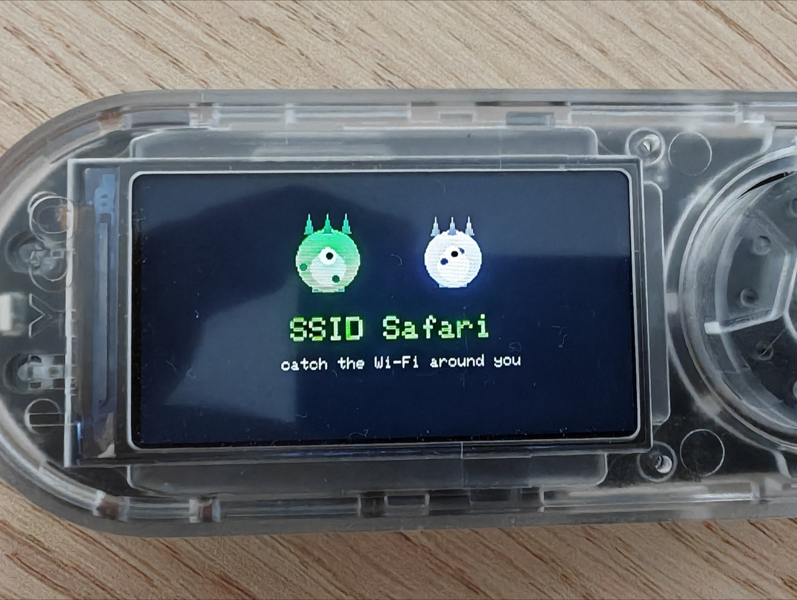
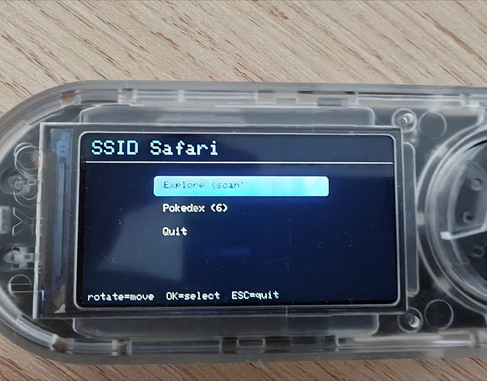
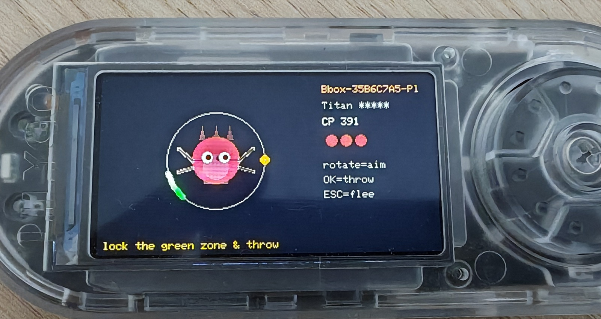

# 🐾 SSID Safari — Bruce / LilyGO T-Embed CC1101

🇺🇸 <b>English</b> · 🇫🇷 <a href="README.fr.md">Français</a>

  [-F7DF1E)](https://github.com/BruceDevices/firmware) 

Catch the **real Wi-Fi networks around you** like little creatures. Every access point becomes a unique, deterministic monster; scan, engage, throw a ball with the rotary, and fill your Pokédex. A pocket **wardriving-meets-monster-collector** — 100% procedural, no image assets.

## 🧬 How creatures are made

Everything is derived from the **real properties of each nearby network** — so the same router is always the same monster:

| Property | Drives | 
|---|---|
| **Encryption** (Open / WEP / WPA / WPA3 / Enterprise / hidden) | the creature's **TYPE**: 🟢 Wild · 🔵 Armor · 🟣 Crystal · 🟤 Fossil · 🔴 Titan · ⚫ Ghost |
| **Vendor** (OUI of the BSSID) | the **species / shape** (blob, spike, bot, bird, bug, golem). A randomized MAC → **Nomad** (phone hotspot) |
| **Signal (RSSI)** | **rarity, CP and catch difficulty** — a faint, rare, well-encrypted AP is a prized catch |
| **BSSID hash** | the **sprite itself** (body, eyes, horns, spots) → each network looks unique |

## 🎮 Catch it with the wheel

Engage a creature and a **lock ring** appears with a drifting **green zone** (smaller & faster for rarer monsters). **Rotate** to aim your cursor into the zone, **click to throw** — a good lock means a better catch. The ball wobbles… caught or fled! Catches are saved to a persistent **Pokédex** (`/ssid_safari.json`).

| Menu | Catch mini-game |
|---|---|
|  |  |

**Controls:** rotate = move / aim · click = select / throw · ESC = back.

## 🚀 Install

1. Copy **`SSID Safari.js`** onto the SD card (e.g. `/scripts` or `/BruceJS`).
2. On the device: **JS Interpreter → select `SSID Safari.js`** (or add it to your favorites with [bruce-launcher](https://github.com/koua29/bruce-launcher)).
3. Play near a few networks — the more crowded the airspace, the better the safari!

> ℹ️ Fully **passive**: it only reads the Wi-Fi beacons that every access point broadcasts publicly (like any Wi-Fi list). It never connects, never attacks — it just turns the airwaves into a game.

## 🛒 Hardware

*Amazon affiliate links: if you buy through these links, the project earns a small commission at no extra cost to you.*

<table>
<tr>
<td align="center" width="33%">
   
  <b><a href="https://www.amazon.com/dp/B0D45MSMJR?linkCode=ll2&amp;tag=koua29bssidsafari-20&amp;ref_=as_li_ss_tl">Anker 545 power bank (10,000 mAh)</a></b> Keeps the T-Embed running away from an outlet
</td>
<td align="center" width="33%">
   
  <b><a href="https://www.amazon.com/dp/B0C1FCZM94?linkCode=ll2&amp;tag=koua29bssidsafari-20&amp;ref_=as_li_ss_tl">433 MHz SMA antenna (2-pack)</a></b> Sub-GHz antenna for the CC1101 radio
</td>
<td align="center" width="33%">
   
  <b><a href="https://www.amazon.com/dp/B0B7NVMBPL?linkCode=ll2&amp;tag=koua29bssidsafari-20&amp;ref_=as_li_ss_tl">SanDisk 64 GB microSD (2-pack)</a></b> For Bruce themes, scripts and captures
</td>
</tr>
</table>

As an Amazon Associate I earn from qualifying purchases.

## 🙏 Credits & License

- Script: **koua29**. Runs on the excellent **[Bruce firmware](https://github.com/BruceDevices/firmware)**.
- Released under the **MIT License** — see [LICENSE](LICENSE).

## ☕ Coffee?

